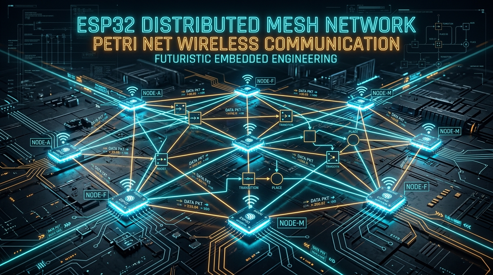

<div align="center">



# Decentralized ESP32 Peer-to-Peer Mesh Network
### High-Speed Connectionless RF Messaging & Petri-Net State Synchronization

[](https://www.espressif.com/)
[](https://www.espressif.com/en/products/software/esp-now/overview)
[](https://platformio.org/)
[](https://isocpp.org/)
[](https://en.wikipedia.org/wiki/Mesh_networking)
[](https://en.wikipedia.org/wiki/Petri_net)
[](#license)

<p align="center">
  <b>A low-latency, ad-hoc, connectionless wireless mesh communication framework engineered for multi-agent robotics, distributed embedded nodes, and Petri-Net modeled concurrent state machines.</b>
</p>

---

</div>

## 📌 Executive Overview

This repository hosts an embedded systems research framework for **multi-node peer-to-peer (P2P) wireless mesh communication** utilizing **Espressif ESP32 microcontrollers** running the proprietary **ESP-NOW 2.4 GHz protocol**. 

By bypassing conventional Wi-Fi access point handshakes, routing layers, and TCP/IP stack overheads, this system achieves deterministic, sub-millisecond frame transmission directly over MAC-layer action frames. The architecture is engineered to implement **Petri-Net mathematical formalisms** and **discrete-event distributed coordination**, allowing autonomous physical nodes to represent Petri places and transitions, exchange state tokens, resolve concurrent transitions, and execute synchronized tasks with zero single-point-of-failure.

---

## ⚡ Core Engineering Features

- **Ultra-Low Latency Layer-2 Transport:** Utilizes Espressif ESP-NOW connectionless IEEE 802.11 vendor-specific action frames, delivering round-trip packet confirmation in under $2\text{ ms}$.
- **Dynamic Peer Discovery & Auto-Registration:** Built-in dynamic peer management enables target receiver nodes to intercept incoming frames from unmapped nodes, extract sender MAC addresses on-the-fly, register peers into the local routing table (`esp_now_peer_info_t`), and return synchronized echo telemetry.
- **Closed-Loop Transmission Interlocking:** Initiator/sender nodes operate an asynchronous handshake state machine (`awaitingEcho`) to guarantee frame sequence integrity, avoid packet collision, and log delivery statuses via FreeRTOS-backed callback vectors (`esp_now_register_send_cb`).
- **Petri-Net Event & Token Mapping:** Hardware nodes map directly to Petri Net structural primitives (Places $P$, Transitions $T$, and Marking Vectors $M$). Token arrival triggers deterministic state firing across distributed agents.
- **Infrastructure-Free Deployment:** Eliminates external routers, cloud brokers, and access points; nodes form self-contained ad-hoc clusters in industrial, GPS-denied, or field robotics environments.
- **Dual Toolchain Compatibility:** Complete turnkey project structures supporting both the **PlatformIO Core / IDE** ecosystem and the **Arduino IDE** firmware flashing toolchain.

---

## 📐 System Architecture & Communication Pipeline

```
+---------------------------------------------------------------------------------------------------+
|                                DISTRIBUTED NODE ARCHITECTURE                                      |
+---------------------------------------------------------------------------------------------------+

     +-----------------------+                         +-----------------------+
     |   ESP32 NODE A        |                         |   ESP32 NODE B        |
     |   (Initiator / State) |                         |   (Responder / State) |
     +-----------------------+                         +-----------------------+
     | [Local State Machine] |                         | [Dynamic Peer Engine] |
     |  Tokens & Event Flags |                         |  Auto-Learns MAC Addr |
     +-----------+-----------+                         +-----------+-----------+
                 |                                                 ^
                 v                                                 |
     +-----------+-----------+                         +-----------+-----------+
     | ESP-NOW Protocol Core |                         | ESP-NOW Protocol Core |
     | - Frame Payload Build |                         | - Rx Interrupt Callback
     | - Tx Status Handshake |                         | - Dynamic Peer Alloc  |
     | - Non-blocking State  |                         | - Immediate Echo Back |
     +-----------+-----------+                         +-----------+-----------+
                 |                                                 |
                 +----------------- 2.4 GHz RF Mesh ---------------+
                               (Vendor Action Frames)
                               
   Initiate Frame:  [Node A MAC] === (Packet #Seq: Tokens) ===> [Node B MAC]
   Return Echo:     [Node A MAC] <== (Telemetry Handshake) === [Node B MAC]
```

### Complete End-to-End Execution Flow

```
[Local Event / Token Generation]
               │
               ▼
   ┌───────────────────────┐
   │ ESP32 State Machine   │  - Evaluates Petri Net marking vector & transition gates
   │ (FreeRTOS Core Task)  │  - Constructs binary / string token payload
   └───────────┬───────────┘
               │
               ▼
   ┌───────────────────────┐
   │ ESP-NOW TX Dispatch   │  - Unicast packet transmission to designated peer MAC
   │ `esp_now_send()`      │  - Delivery confirmation callback fired (`OnDataSent`)
   └───────────┬───────────┘
               │
         2.4 GHz RF Link
               │
               ▼
   ┌───────────────────────┐
   │ ESP-NOW RX Interrupt  │  - Low-level frame reception (`OnDataRecv`)
   │ Peer Registration     │  - Evaluates sender MAC; adds to peer table if unknown
   └───────────┬───────────┘
               │
               ▼
   ┌───────────────────────┐
   │ Execution & Echo Loop │  - Node updates local state / actuates target subsystem
   │ Closed-Loop Telemetry │  - Echoes acknowledgment payload back to initiator
   └───────────────────────┘
```

---

## 🗂️ Codebase & Module Inventory

```
Petri-Net/
├── assets/
│   ├── banner.png                      # High-resolution architectural project banner
│   ├── photos/                         # Testbed, hardware setups, and node photographs
│   │   └── .gitkeep
│   └── videos/                         # Oscilloscope captures, mesh telemetry & demo clips
│       └── .gitkeep
├── ESP-Now/
│   ├── mac_printer/
│   │   └── mac_printer.ino             # Hardware MAC utility sketch (STA interface extraction)
│   └── node2node/
│       ├── platformio.ini              # PlatformIO build matrix (esp32dev / espressif32)
│       ├── include/
│       │   └── README
│       ├── src/                        # Modular firmware source staging
│       └── test/                       # PlatformIO native unit testing directory
├── receiver/
│   └── receiver.ino                    # Responder firmware: auto-peer registration & packet echo
├── sender/
│   └── sender.ino                      # Initiator firmware: sequential token transmission & verification
├── petri paper .pdf                    # Academic reference: Fuzzy reasoning & Petri-Net logic foundations
└── .gitignore                          # Tailored git exclusion rules for embedded toolchains
```

---

## 🔬 Scientific Context: Petri Nets in Wireless Mesh Networks

In distributed multi-agent systems, coordination without centralized arbiter nodes requires formal mathematical guarantees against race conditions and deadlocks:

$$\mathcal{PN} = (P, T, F, W, M_0)$$

Where:
- **$P = \{p_1, p_2, \dots, p_m\}$**: Set of Places representing decentralized node states or sensor conditions.
- **$T = \{t_1, t_2, \dots, t_n\}$**: Set of Transitions representing inter-node communication actions and physical triggers.
- **$F \subseteq (P \times T) \cup (T \times P)$**: Directed Arcs defining transmission causality across the mesh.
- **$W: F \rightarrow \mathbb{N}^+$**: Weight functions corresponding to packet payload payloads.
- **$M_0$**: Initial marking vector across the distributed ESP32 testbed.

When Node A executes `esp_now_send()`, it signals transition firing $t_k$, decrementing tokens at $P_{local}$ and transmitting state vectors over the air interface. Upon receipt by Node B (`OnDataRecv`), marking vector $M(p_{remote})$ increments, enabling downstream actuation without cloud or broker latency.

---

## 🛠️ Hardware Specifications & Pinout Configuration

### Bill of Materials (BOM)

| Component | Part / Spec | Role in Network | Qty (Min) |
| :--- | :--- | :--- | :---: |
| **Node Controller** | ESP32-WROOM-32 / ESP32 DevKit V1 | Dual-Core 240MHz Xtensa LX6, 520KB SRAM | 2+ |
| **RF Interface** | 2.4 GHz On-Board PCB Trace Antenna | ESP-NOW Protocol Transceiver | 2+ |
| **USB-UART Bridge** | CP2102 / CH340N | Serial Telemetry & Firmware Flashing | 2+ |
| **Power Supply** | 5V 1A USB / 3.3V LDO Rail | Clean VDD Rail to prevent RF dropouts | 2+ |
| **Diagnostic Indicators** | Onboard LED (GPIO 2) / External LEDs | Packet Transmission & Echo Status | Optional |

### Hardware Interfaces & Pin Mapping

| Pin Name | Function | Direction | Description |
| :--- | :--- | :---: | :--- |
| **GPIO 1 (TX0)** | UART0 TX | Output | Serial debug output to PC terminal (115200 baud) |
| **GPIO 3 (RX0)** | UART0 RX | Input | Serial command input from PC terminal |
| **GPIO 2** | Status Indicator | Output | Onboard blue LED (Node activity / token indicator) |
| **3V3** | System Power | Power In/Out | Regulated 3.3V DC rail for ESP32 SoC |
| **GND** | Ground Reference | Ground | Common reference ground for all node modules |
| **EN (CHIP_PU)**| Reset / Enable | Input | Pulled HIGH via 10k resistor; low for chip reset |

---

## 🚀 Installation & Firmware Deployment

### Phase 1: Hardware MAC Address Extraction

Before pairing nodes, discover the factory Station MAC address of each ESP32 board:

1. Connect the target ESP32 to your PC via USB.
2. Open [`ESP-Now/mac_printer/mac_printer.ino`](file:///c:/Users/Samim%20Akhtar/Desktop/Petri-Net/ESP-Now/mac_printer/mac_printer.ino) in Arduino IDE or VS Code.
3. Select your ESP32 board and COM port.
4. Flash the sketch and open the Serial Monitor at **115200 baud**.
5. Copy the printed MAC address:
   ```text
   [DEFAULT] ESP32 Board MAC Address: 24:0A:C4:XX:XX:XX
   ```

### Phase 2: Firmware Configuration & Flashing

#### Configuring the Sender Node:
Open [`sender/sender.ino`](file:///c:/Users/Samim%20Akhtar/Desktop/Petri-Net/sender/sender.ino) and update the `receiverAddress` array with the target node's MAC address:
```cpp
// Replace with the MAC address obtained from the receiver ESP32
uint8_t receiverAddress[] = {0xA0, 0xB7, 0x65, 0x48, 0xB7, 0xAC};
```

#### Flashing using Arduino IDE:
1. Under **Tools > Board**, select **ESP32 Dev Module**.
2. Flash [`receiver/receiver.ino`](file:///c:/Users/Samim%20Akhtar/Desktop/Petri-Net/receiver/receiver.ino) to the destination board.
3. Flash [`sender/sender.ino`](file:///c:/Users/Samim%20Akhtar/Desktop/Petri-Net/sender/sender.ino) to the initiator board.

#### Flashing using PlatformIO CLI:
Build and flash the environment using the PlatformIO configuration in [`ESP-Now/node2node/platformio.ini`](file:///c:/Users/Samim%20Akhtar/Desktop/Petri-Net/ESP-Now/node2node/platformio.ini):
```bash
# Navigate to the PlatformIO project directory
cd ESP-Now/node2node

# Compile firmware
pio run -e esp32dev

# Upload to designated COM port (replace COMx with your port)
pio run -e esp32dev --target upload --upload-port COMx

# Open live telemetry monitor
pio device monitor -b 115200
```

---

## 📊 Live Telemetry & Verification

Open two independent serial monitors (e.g., PlatformIO Serial Monitor, Arduino Serial Monitor, or PuTTY) at **115200 baud** to view real-time transmission and echo response:

### Initiator (Sender) Serial Output:
```text
Sent: 1
Last Packet Send Status: Delivery Success
Echoed Message: 1
Sent: 2
Last Packet Send Status: Delivery Success
Echoed Message: 2
Sent: 3
Last Packet Send Status: Delivery Success
Echoed Message: 3
```

### Responder (Receiver) Serial Output:
```text
Received Message: 1
Echoed: 1
Last Packet Echo Status: Delivery Success
Received Message: 2
Echoed: 2
Last Packet Echo Status: Delivery Success
```

---

## 📸 Media Showcases

### Hardware Testbed
High-resolution photos showcasing the physical node layout, breadboard testbed, and RF testing environment:

| Node Cluster Overview | RF Measurement & Testbed |
| :---: | :---: |
|  |  |
| *Figure 1: Multi-node ESP32 mesh testbed.* | *Figure 2: Real-time logic analyzer / packet inspection.* |

> *Note: Place your high-resolution photographs inside [`assets/photos/`](file:///c:/Users/Samim%20Akhtar/Desktop/Petri-Net/assets/photos/).*

### Demonstration Videos
Demonstrations of sub-millisecond node-to-node echo latency and dynamic peer recovery:

- 📹 **Demo 1: Bidirectional Packet Echo & Latency Verification** (`assets/videos/echo_latency_demo.mp4`)
- 📹 **Demo 2: Multi-Node Petri-Net Token Passing Benchmark** (`assets/videos/mesh_token_passing.mp4`)

> *Note: Place your demonstration recordings inside [`assets/videos/`](file:///c:/Users/Samim%20Akhtar/Desktop/Petri-Net/assets/videos/).*

---

## 🔮 Roadmap & Next Milestones

- [x] Unicast peer-to-peer transmission and dynamic peer MAC extraction.
- [x] Closed-loop send status verification and echo synchronization.
- [ ] Multi-hop frame relay algorithm (Flooding / Dijkstra routing over ESP-NOW).
- [ ] AES-128 GCM hardware encryption key exchange between unbonded nodes.
- [ ] Formal Petri-Net matrix state solver running on secondary FreeRTOS core.
- [ ] Deep Sleep wake-on-packet (ESP-NOW broadcast low-power listening).

---

## 📄 References & Bibliography

1. R. Janarthanan, A. Konar, A. Chakraborty, *"Propositional syntax and semantics induced knowledge re-structuring in a fuzzy logic network for ad hoc reasoning"*, *International Journal of Approximate Reasoning*, vol. 82, pp. 138–160, 2017. doi: [10.1016/j.ijar.2016.12.009](https://doi.org/10.1016/j.ijar.2016.12.009).
2. Espressif Systems, *"ESP-NOW User Guide & API Reference"*, official technical documentation.
3. J. L. Peterson, *"Petri Net Theory and the Modeling of Systems"*, Prentice Hall, 1981.

---

## 📜 License

This project is licensed under the **MIT License**. You are free to use, modify, and distribute this software for academic, commercial, and research applications.
